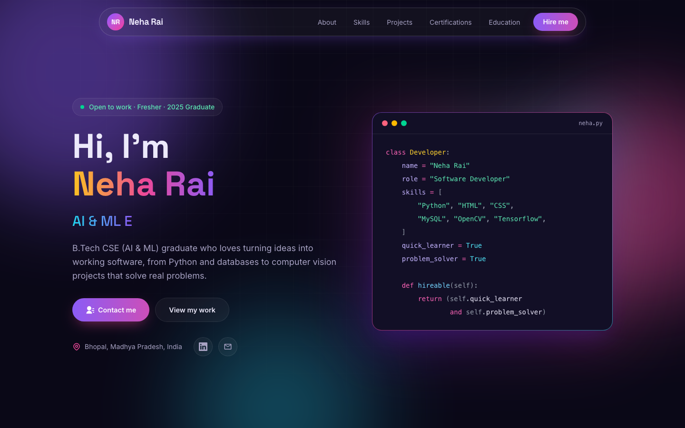

<h1 align="center">Neha Rai · Portfolio</h1>

<p align="center">
  <strong>Personal portfolio of Neha Rai, a Software Developer and B.Tech CSE (AI &amp; ML) graduate.</strong>
</p>

<p align="center">
  
  
  
</p>

<p align="center">
  
</p>

---

## About

Hi, I'm **Neha Rai**, a Software Developer and 2025 B.Tech graduate in Computer Science &amp; Engineering
(specialization in AI &amp; ML) from **LNCT Bhopal (RGPV)**. I have a strong foundation in DSA and OOPS, and work with Python, MySQL, HTML and CSS,
along with OpenCV and TensorFlow for computer vision and machine learning.

- 📍 Bhopal, Madhya Pradesh, India
- 📧 [raineha5589@gmail.com](mailto:raineha5589@gmail.com)
- 💼 [LinkedIn](https://www.linkedin.com/in/neha-rai-06aab0255/)

### Projects

| Project | Description | Tech |
| --- | --- | --- |
| **Driver Drowsiness Detection System** | Face recognition based car safety system that watches the driver in real time and raises an alarm on signs of drowsiness. | Python, OpenCV, dlib, TensorFlow |
| **Language Identification System** | Identifies the language of a text using NLP and a Naive Bayes classifier. | Python, NLP, NLTK |

### Certifications

- iCloud Security Alliance · Cisco
- Introduction to Cybersecurity · Cisco
- AWS Cloud Practitioner Essentials · AWS Academy
- Introduction to Machine Learning: Art of the Possible · AWS
- Introduction to AWS Inferentia and Amazon EC2 Inf1 Instances · AWS

---

## Site sections

| Section | What it shows |
| --- | --- |
| Hero | Name, animated role text, quick links |
| About | Bio, languages and highlights |
| Skills | Tech stack with icons |
| Projects | Project cards with tools and links |
| Certifications | Cisco and AWS courses |
| Education | B.Tech, 12th and 10th timeline |
| Contact | Contact form plus email, location and LinkedIn |

Experience, Apps, GitHub, Resume and Phone are hidden automatically while their data is empty.

---

## Run locally

Requires **Node.js 20.9+**.

```bash
npm install
npm run dev
```

Open <http://localhost:3001>.

Production build:

```bash
npm run build
npm start
```

---

## Updating the content

All content lives in `utils/data/`. Edit these files to change what the site shows:

| File | Contents |
| --- | --- |
| `personal-data.js` | Name, role, bio, email, location, LinkedIn, `github`, `resume`, `profile` photo, languages |
| `skills.js` | Skills list (see the list of supported icons at the bottom of the file) |
| `projects-data.js` | Projects (add `code` / `demo` links to show buttons) |
| `certifications.js` | Certifications (add `link` to show a "View credential" button) |
| `educations.js` | Education timeline |
| `experience.js` | Work experience (empty for now, so the section is hidden) |
| `apps-data.js` | Published apps (empty for now, so the section is hidden) |

**To add a profile photo:** put the image in `public/` (for example `public/neha.jpg`) and set
`profile: '/neha.jpg'` in `personal-data.js`.

**To add a resume:** set `resume` in `personal-data.js` to a public Google Drive link. The
"Get Resume" button will appear.

**To add GitHub:** set `github` in `personal-data.js` to your profile URL. The GitHub icons will appear.

---

## Environment variables

Copy `.env.example` to `.env` and fill in the values. They are only needed for the contact form and
analytics.

| Variable | Purpose |
| --- | --- |
| `NEXT_PUBLIC_APP_URL` | Public site URL, used by the contact form and for SEO / share previews |
| `EMAIL_ADDRESS` | Gmail address that receives contact form messages |
| `GMAIL_PASSKEY` | Gmail [App Password](https://myaccount.google.com/apppasswords) for that address |
| `TELEGRAM_BOT_TOKEN` / `TELEGRAM_CHAT_ID` | Optional: also send contact messages to Telegram |
| `NEXT_PUBLIC_GTM` | Optional: Google Tag Manager ID |

---

## Deployment

The site works on any Node.js host. On [Vercel](https://vercel.com): import the repository, add the
environment variables above, and deploy. Set `NEXT_PUBLIC_APP_URL` to the final site URL so share
previews and the sitemap use the right address.

Docker files (`Dockerfile.dev`, `Dockerfile.prod`, `docker-compose.yml`) are also included.

---

## Credits

Built on the open-source [developer-portfolio](https://github.com/hhhrrrttt222111/developer-portfolio)
Next.js template, with a custom redesign.
